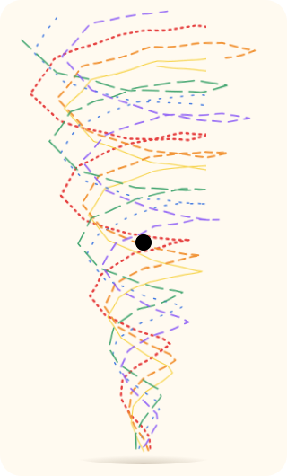
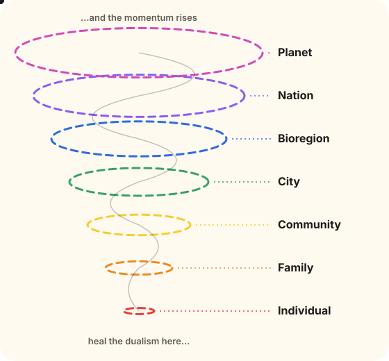

Every dialectic in this section ends the same way: done well, each side makes the other stronger. That's what we call an upward spiral. 

## It starts with one person

An upward spiral is created when we resolve a dualism at the individual level.

A person who has brought love and money into alignment, whose time, attention and spending actually follow what they care about, is no longer pulled in two directions. The same is true of the other pairs: sovereignty and interdependence, being and doing, gift and exchange. Each one you work through in your own life frees up energy that was going into friction.

That doesn't stay inside one person.

## Then it climbs the stack

If you resolve the dualisms and frictions inside a family, the family gets healthier, and a healthier family makes its community healthier. Resolve them within a community and the city gets healthier. And so on, all the way up the stack to the global ecosystem.

Each level is made of the one below it. A city is many communities, a community is many families, a family is a few people. So healing at the bottom isn't a small, private act. It's how the larger systems change, one layer at a time. Momentum starts at the individual level, bubbles up and builds as it rises.

This is the same idea the [Love x Funding](/ontology/dialectic/) page starts from: changed people change a society.

## What travels up

The spiral doesn't only lift one thing. It lifts eight forms of capital:

| Capital      | What it is                                                         |
| ------------ | ------------------------------------------------------------------ |
| Social       | Relationships, trust and connection                                |
| Financial    | Money and investment flowing to the work worth doing               |
| Living       | Soil, plants, animals and ecosystems                               |
| Material     | Buildings, tools, technology and shipped code                      |
| Intellectual | Knowledge, skills and expertise                                    |
| Experiential | What you learn by doing, so each cycle teaches the next            |
| Cultural     | Shared traditions, stories and social fabric                       |
| Spiritual    | Purpose, connection and the felt sense that the work matters       |

Money is one of eight. A family that has made peace between love and money might not get richer in dollars at all, but it gets richer in trust, in purpose and in what it can give to the people around it.

## The opposite: a downward spiral

Spirals run both ways. Unresolved dualisms compound too. A person torn between what they love and what pays burns out. A family under that strain fractures. A community full of fractured families loses its trust, and a city full of those communities drifts toward extraction and exhaustion.

The direction of the spiral at the top is set, in large part, by what happens at the bottom.

## Why love.fund

love.fund funds what matters. When money flows toward what people actually love, it helps resolve the love x money dualism for the people giving and the people receiving. Every project funded this way is a small place where the spiral turns upward.

By combining love and funding, and by working through the other dualisms in this section, we can heal at the individual level and let the momentum build upward. That's the upward spiral for humanity, and love.fund's aim is to start them everywhere.
